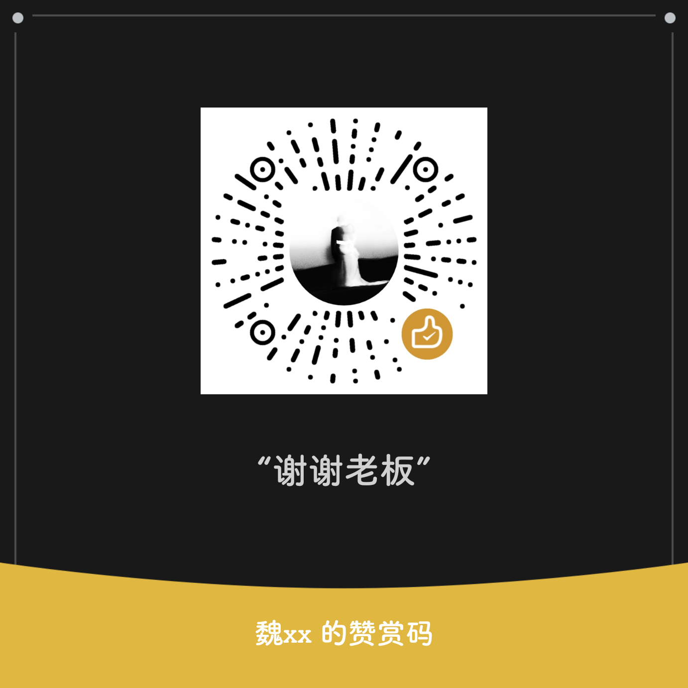

# DouAi

[☕ 请我喝杯咖啡](#赞助)

DouAi 是面向抖音的增强模块，作者 **yudigaga**。本仓库提供 LSPosed 模块介绍及正式 APK。

当前正式版：**0.2.66 / 167**。

[下载 DouAi-0.2.66.apk](https://github.com/Xposed-Modules-Repo/io.github.yudigaga.douai/releases/download/167-0.2.66/DouAi-0.2.66.apk) · [源码仓库](https://github.com/yudigaga/DouAi)

本版修复组件隐藏开启时评论区锁屏再点亮后的底部导航恢复，并完成试听和本地分析读取等优化。详细变化与验证范围见 [发布记录](https://github.com/yudigaga/DouAi/blob/main/docs/release-0.2.66.md)。

## 核心功能

- 推荐流与顶部标签筛选、组件隐藏及独立透明度调整。
- 播放手势、自动播放、播放速度、画面裁切与沉浸显示。
- 原生和第三方下载扩展、自定义保存目录、下载任务进度与取消。
- 评论与语音工具，支持系统及第三方语音、音色选择与随机音色。
- 自动回复、自动评论和续火花，支持名单范围、内容筛选及 AI 模型。
- 用户资料与聚合目录、原生用户搜索、关系筛选及群聊范围配置。
- 模型与分层提示词、素材测试、AI 消息联系人和独立对话。
- 配置导入/导出、本地数据分析与个人内容年志，支持 PNG/PDF 分享。

功能以对应宿主的适配规则和设置页为准，不保证其他版本或构建兼容。

## 环境与适配

- Android 9 或以上，支持 libxposed API 102 的 LSPosed。
- 作用域：抖音 `com.ss.android.ugc.aweme`。
- 抖音 40.6.0 / 400601。
- 抖音 40.8.0 / 400801，内部构建 40809900。
- 抖音 41.0.0 / 410001，内部构建 41009900。

## 安装与使用

1. 下载正式 APK 并安装；后续正式版使用同一签名，可覆盖更新。
2. 在 LSPosed 中启用 DouAi，作用域只选择抖音。
3. 完全退出并重新打开抖音，在抖音设置中的 DouAi 入口配置功能。

从旧 `com.douai.module` Debug 包迁移时，先卸载旧模块，再安装并启用正式包，避免重复 Hook。

模块应用提供框架连接、扫描诊断、隐藏桌面图标和关于入口。模块设置的“关于 → 帮助”可离线查看说明。

## 升级与数据

当前分析数据库为 **SQLite v4**，分析备份导出为 **v3**，仍可导入旧 v1/v2 分析备份。**不要用旧版程序直接打开新版数据库。**

本地分析记录默认关闭；主动点击请求 AI 时才发送分析摘要。

## 文档

- [文档目录](https://github.com/yudigaga/DouAi/blob/main/docs/README.md)。
- [完整帮助](https://github.com/yudigaga/DouAi/blob/main/docs/help.md)。
- [0.2.64 发布记录](https://github.com/yudigaga/DouAi/blob/main/docs/release-0.2.64.md)。
- [构建与发布状态](https://github.com/yudigaga/DouAi/blob/main/docs/releasing.md)。
- [个人内容年志](https://github.com/yudigaga/DouAi/blob/main/docs/portrait-analysis.md)。

历史安装包见 [本仓库 Releases](https://github.com/Xposed-Modules-Repo/io.github.yudigaga.douai/releases)，历史说明从主仓文档目录查阅。

## 赞助

如果你喜欢 DouAi，欢迎请我喝杯咖啡 ☕，感谢支持！

## 免责协议

本项目仅用于学习与技术研究。用户的应用、配置、二次开发及使用行为和结果由用户自行决定并承担责任，与本项目及作者无关。完整责任边界见 [免责协议](DISCLAIMER.md)，APK 关于页也可查看。

## 致谢

感谢 [Miuix](https://github.com/compose-miuix-ui/miuix) 提供 UI。其他依赖与设计参考见 [第三方说明](https://github.com/yudigaga/DouAi/blob/main/THIRD_PARTY_NOTICES.md)。
